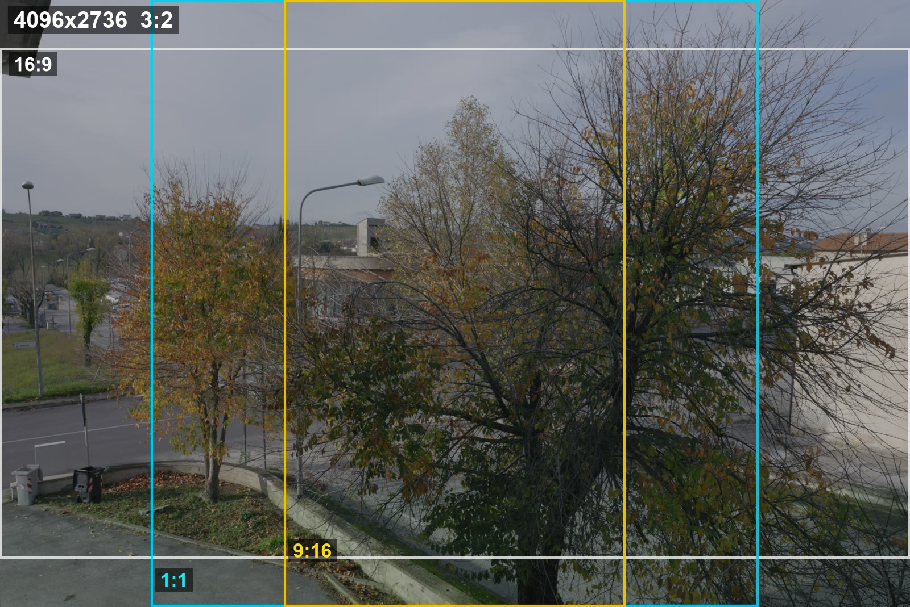
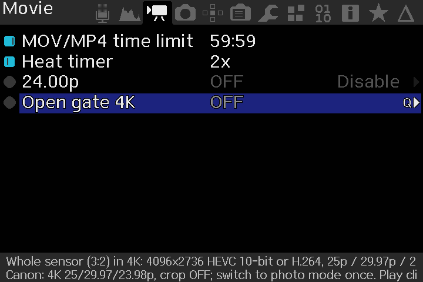
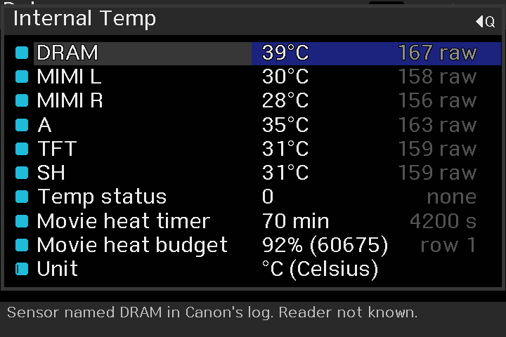

Magic Lantern for the Canon EOS R6
==================================

**Open gate 4K in 3:2 and 4:3, anamorphic preview, true 24.00p, one-hour clips and more, on the original EOS R6 (firmware 1.9.0).**

Magic Lantern (ML) runs next to Canon's firmware, straight from the memory card. This unofficial
fork brings it to the R6, with extra video features.

> **Experimental and unofficial.** It is not an official Magic Lantern release and not endorsed by
> the ML team, so please report problems here, not to them. The R6 code was written with the help
> of AI (it started from andrewpoison's LLM-assisted port and was extended with Claude), and every
> such commit says so. It has been tested on one camera, comes with no warranty (GPL, see
> [`COPYING`](COPYING)), and is not for work that matters yet.

## What's new on the R6

| | Feature | What you get |
|---|---|---|
| 🎞️ | **Open gate 4K** | Record the **whole sensor height**: 4096x2736 in 3:2, or 3840x2880 in 4:3 for anamorphic lenses. HEVC 4:2:2 10-bit with Canon Log, or H.264. 25p, 29.97p, 23.98p. Play the clips on a computer. *Module, experimental.* |
| 🔭 | **Anamorphic preview** | See your anamorphic lens **desqueezed** on the screen and in the viewfinder, sharp and smooth, also while recording. 1.25x to 2x, with open gate 4:3 too. |
| 🎬 | **True 24.00p** | Cinema 24.00 fps in 4K UHD, with Canon's own 24.00p setting. *Module, experimental.* |
| ⏱️ | **Clips up to 59:59** | Record for an hour in one clip, and play it back on the camera. High frame rate (100/120p) up to 29:59. |
| 🌡️ | **Heat timer 2x / 3x / 4x** | Slows Canon's time-based 4K limit. The real temperature sensors still protect the camera. |
| 💾 | **Format and keep ML** | Format the card from Canon's menu and ML is put back for you ("Format card, keep ML"). |
| 🖼️ | **Cropmarks** | Framing guides on the LiveView, including your own bitmaps. |

The modules sit in the **Modules** tab and turn on from the ML menu; open gate and 24.00p are
used one at a time. Their limits are in their own info screen on the camera.

### Open gate 4K

The whole sensor height in one frame: frame it once, then crop the same clip for widescreen,
square and vertical. With an anamorphic lens, choose 4:3: 3840x2880 from the full sensor height,
ready to desqueeze in post. **Display > Anamorphic** shows it desqueezed while you shoot.

 
<em>One open gate frame from the R6: 4096x2736, with room for 16:9, 1:1 and 9:16.</em>

### On the camera

<table>
<tr>
<td width="50%"></td>
<td width="50%"> Internal Temp: the R6's temperature sensors, heat timer and heat budget"></td>
</tr>
<tr>
<td align="center"><em>The Movie menu: clip length, heat timer, 24.00p and open gate.</em></td>
<td align="center"><em>Internal Temp: every sensor, the heat timer and the heat budget, live.</em></td>
</tr>
</table>

## Also included

- **Spotmeter, false color, waveform and vectorscope**, in photo and movie mode, also while recording.
- **Temperatures and the heat timer** in the LiveView bar, **battery in %**.
- **ML menu while recording**, with the dials moving the menu.
- **Red display** for night and astro, motion detect, screenshots, Lua scripts, file manager.
- **USB file transfer** (PTP) on builds that enable it.

Zebras, focus peaking, the histogram, the intervalometer and the bulb timer are left to Canon,
which already does them well. Not available yet: RAW / MLV video, dual ISO, silent pictures, and
Lua scripts that change camera settings.

## Getting started

Your camera must be on firmware **1.9.0** (Canon menu > Setup > Firmware). Any other firmware:
ML refuses to start.

1. **Turn on the boot flag**, once, with the script in [`tools/r6/bootflag-enable/`](tools/r6/bootflag-enable/)
   (an SDHC card of 32 GB or less, in slot 2).
2. **Prepare the card**: format it in the camera, unzip `magiclantern.zip` to it, and set the card
   flags with the tools in [`tools/r6/`](tools/r6/).
3. **Power on** and press the **Trash** button: that's the ML menu.

The full walkthrough is in [INSTALL](docs/r6/INSTALL.md).

## Guides

- [Installing](docs/r6/INSTALL.md)
- [Using ML on the R6](docs/r6/USAGE.md): buttons, every feature, updating
- [Troubleshooting](docs/r6/TROUBLESHOOTING.md)
- [Overheating and the 29:59 limit](docs/r6/OVERHEAT.md)
- [USB / PTP transfer](docs/r6/USB-PTP.md)

On the camera, press **INFO** on a menu entry for its help page.

## Problems and ideas

Open an issue in this repository. Say which build you used and what you did step by step. If the
camera hung, say how it came back (battery pull, card out).

## Thanks

- The **Magic Lantern** developers, for ML and the DIGIC X groundwork: [magiclantern.fm](https://www.magiclantern.fm/)
- **andrewpoison**, for the first R6 1.9.0 port
- **lclevy**, for the [Canon Basic examples](https://github.com/lclevy/cbasic_examples) behind the boot flag scripts
- The **CHDK** project, for the PTP protocol and `ptpcam`

GPL v2, like Magic Lantern. Canon and EOS are trademarks of Canon Inc.; this project is not
affiliated with Canon.
